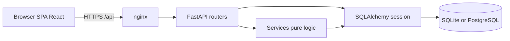
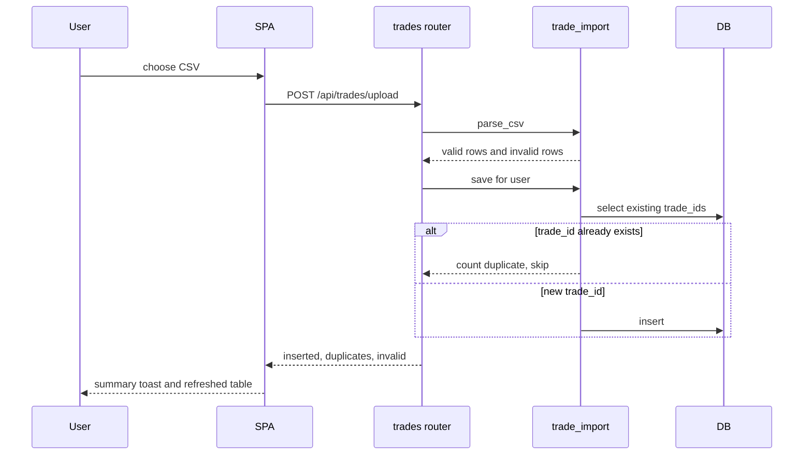

# Architecture – F&O Business Portfolio Tracker

## Complexity and task plan
**Rating: medium** (backend + frontend + Docker Compose, auth, CSV ingestion, 5 pages, no external integrations).
Suggested task count: **10–14** (backend skeleton/auth, models, investments API, tradebook import/list, P&L, targets, backend tests, frontend shell/login, Home, TradeBook, P&L, Targets, Docker/compose, docs).

## Assumptions (vision is ambiguous; these are decisions)
- Financial year (FY) = 1 Apr – 31 Mar, labelled e.g. `2026-27`. Every data endpoint takes `fy`. "Archiving" = nothing is ever deleted or overwritten; selecting a past FY simply queries that period (derived from dates). No separate archive tables.
- Multi-user: every row has `user_id`; every query is filtered by the authenticated user. Self-registration is allowed on the login page (small "Create account" toggle).
- Trade uniqueness key: `(user_id, trade_id)`. Duplicates in an uploaded CSV are skipped, never updated; the response reports `inserted`, `duplicates`, `invalid`.
- Underlying (NIFTY / SENSEX) is derived from the symbol prefix. Other symbols are grouped under `OTHER`.
- Realised P&L per (underlying, expiry_date) = Σ(sell qty × price) − Σ(buy qty × price). If net quantity of any symbol in the group ≠ 0 the expiry is flagged `open` (P&L is then partial). Charges/taxes are out of scope.
- Targets: yearly = 10% of total invested value in the FY; quarterly = yearly/4; monthly = yearly/12; weekly = yearly/52. "Achieved" = realised P&L of expiries falling in the current period (the current quarter/month/week of the selected FY; for a past FY the last period in that FY). Indicator: Met (achieved ≥ target), In progress (>0), Behind (≤0), with a progress bar.
- Invested value on Home = sum of invested entries (dated deposits). Growth graph = cumulative (invested + interest) over time within the FY, plus a second line for cumulative invested.
- Versions below could not be web-verified in this stage (search returned nothing); they are conservative, known-good pins. Implementers should keep them unless install fails.

## Stack
| Layer | Choice | Why |
|---|---|---|
| Backend | Python 3.12, FastAPI 0.115, Pydantic 2, SQLAlchemy 2.0, uvicorn 0.30 | Minimal code, typed validation at boundary, automatic OpenAPI |
| Auth | PyJWT 2.9 (HS256, 8h) + `bcrypt` 4.2 password hashes | Boring, stateless |
| DB | SQLite file (dev/test/default compose, volume `/data`); PostgreSQL by setting `DATABASE_URL` (add `psycopg[binary]` only if used) | No server needed to test; prod switch is config |
| Frontend | React 18.3 + TypeScript 5 + Vite 5.4, react-router 6, Recharts 2.12, plain CSS (one `styles.css`, CSS variables) | Small, no UI framework weight |
| Frontend tests | Vitest + Testing Library (a few tests) | |
| Backend tests | pytest 8 + httpx (FastAPI TestClient), in-memory SQLite | |
| Serving | nginx 1.27 alpine serves built SPA and proxies `/api` to backend | Single origin, no CORS |
| Orchestration | Docker Compose: `backend`, `frontend`; named volume for SQLite | |

## File structure
```
AGENTS.md
docker-compose.yml
.env.example                  # JWT_SECRET, DATABASE_URL (no real secrets)
backend/
  Dockerfile
  requirements.txt
  app/
    main.py                   # app factory, router wiring
    config.py                 # env settings
    db.py                     # engine, session dependency
    models.py                 # SQLAlchemy models
    schemas.py                # Pydantic models
    security.py               # hashing, JWT, current_user dependency
    fy.py                     # financial-year helpers (pure)
    routers/ auth.py investments.py trades.py pnl.py targets.py
    services/ trade_import.py pnl.py targets.py   # pure logic, no HTTP
  tests/
frontend/
  Dockerfile  nginx.conf  package.json  vite.config.ts
  src/
    main.tsx App.tsx styles.css
    api.ts                    # fetch wrapper + token handling
    auth.tsx                  # AuthContext
    components/ Layout.tsx FySelect.tsx Table.tsx Pager.tsx Card.tsx Empty.tsx
    pages/ Login.tsx Home.tsx TradeBook.tsx PnL.tsx Targets.tsx
```

## Component flow


## HLD
- **Routers** (HTTP only: auth, validation, status codes) → **services** (import parsing, P&L, targets; take plain data/session, no FastAPI imports) → **models**. Services are unit-testable without HTTP.
- **Frontend** pages call only `api.ts`; layout provides sidebar nav, header with user and FY selector (FY kept in a context so all pages share it).

## LLD
### Data models (all have `id`, `user_id` FK indexed)
- `User(email unique, password_hash, created_at)`
- `Holding(name, kind[gsec|mutual_fund|other], amount, as_of_date)`
- `Interest(date, amount, note)`
- `Investment(date, amount, note)`
- `Trade(symbol, isin, trade_date, exchange, segment, series, trade_type[buy|sell], auction bool, quantity Numeric, price Numeric, trade_id, order_id, order_execution_time, expiry_date, underlying)`; `UniqueConstraint(user_id, trade_id)`; index (user_id, trade_date), (user_id, expiry_date). Use `Numeric`/Decimal for money.

### Endpoints (all except auth require `Authorization: Bearer`)
- `POST /api/auth/register`, `POST /api/auth/login` → `{access_token}`; `GET /api/auth/me`
- `GET /api/fy` → list of FYs that have data (+ current)
- `GET|POST /api/holdings`, `DELETE /api/holdings/{id}` (`fy` filter on as_of_date)
- `GET|POST /api/interest`, `GET|POST /api/investments` (`fy`), delete by id
- `GET /api/summary?fy=` → totals + growth series `[{date, invested, total}]`
- `POST /api/trades/upload` (multipart CSV; max 5 MB; header must match columns) → `{inserted, duplicates, invalid:[{row, reason}]}`
- `GET /api/trades?fy=&page=&page_size=15` → `{items,total,page,page_size}` sorted by execution time desc
- `GET /api/pnl?fy=&underlying=NIFTY|SENSEX` → rows per expiry `{expiry_date, underlying, trades, pnl, open}` + total
- `GET /api/targets?fy=` → four cards `{period, label, target, achieved, status, progress}`

### Key functions
`fy.fy_range(label)`, `fy.fy_of(date)`, `trade_import.parse_csv(stream) -> (valid rows, invalid)`, `trade_import.save(session, user_id, rows)`, `pnl.by_expiry(trades)`, `targets.build(invested, pnl_by_expiry, fy, today)`.

### Import flow


## Security
- bcrypt hashes; JWT secret from env (`JWT_SECRET`, compose refuses to start without it via `${JWT_SECRET:?}`); ORM-parameterised queries only; every query scoped by `user_id`; CSV size cap, strict header check, per-row validation (enum, numeric, ISO dates); Pydantic validation on all bodies; React escapes output (no `dangerouslySetInnerHTML`). Terminate HTTPS at a reverse proxy in production. Basic login rate limiting is out of scope (noted).

## UI approach
Enterprise light theme: single `styles.css` with CSS variables (white/slate-50 surfaces, slate text, indigo primary, green/amber/red status), 8px spacing grid, system font (Inter if available). Layout: fixed left sidebar (Home, TradeBook, P&L, Target) + top bar (FY dropdown, user, logout); protected routes redirect to Login. Tables: sticky header, zebra/hover rows, right-aligned numerics, green/red P&L, pager (15 rows/page). Forms: labelled inputs, inline validation, disabled-while-submitting buttons. Cards for targets with progress bar and status badge. Growth chart via Recharts area/line chart. Responsive: sidebar collapses to top nav under 768px, tables scroll horizontally, cards stack in a grid. States: skeleton/“Loading…”, friendly empty states with a call to action (e.g. “Upload your first CSV”), inline error banners, toast on success.

## Patterns
- Chosen: layered router/service/model split (keeps logic decoupled from HTTP and DB); FastAPI dependency injection for session and current user; context provider for auth and FY on frontend.
- Rejected: repository abstraction (SQLAlchemy session already is one; add only if a second store appears), CQRS/event bus, microservices, Redux (context is enough), UI component framework (plain CSS is smaller), Alembic migrations initially (use `create_all`; add Alembic if schema must evolve in production), separate archive tables.

## Docker
`docker-compose.yml`: `backend` (build ./backend, env `DATABASE_URL=sqlite:////data/app.db`, `JWT_SECRET`, volume `data:/data`, not published), `frontend` (multi-stage: node build → nginx; publishes `8080:80`; proxies `/api/` to `backend:8000`). Backend healthcheck on `/api/health`.
